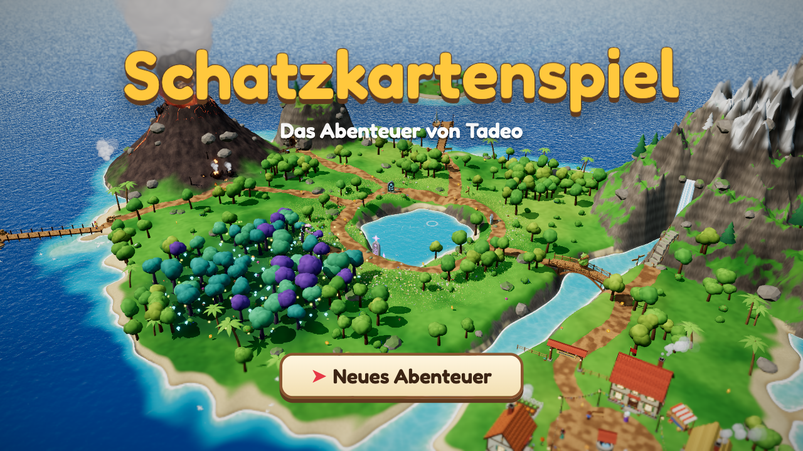

# Schatzkartenspiel

A 3D treasure-hunt adventure built with **Three.js**, **TypeScript** and **Vite**, made for Tadeo
(7 years old). You play as **Tadeo** with his hen **Chuleta**: explore a lush toon-style island,
solve ten quests in their own mini-game worlds, help the villagers and find the king's treasure.
All text and narration are in German.



## Highlights

- Hand-built 3D island: shader water with shore foam, wind-blown grass, instanced vegetation,
  volcano smoke, chimney smoke, birds, butterflies, crabs, fireflies, waterfall and river
- Four regions around the old island, linked by paths and signposts: a lagoon with a jetty, beach huts,
  turtles and dolphins; a misty jungle with an old ruin and parrots; a swamp with a boardwalk, frogs and
  fireflies; flower hills with a windmill and sheep
- Post-processing: bloom, tilt-shift, ACES tone mapping, vignette
- Rendering capped at 60 FPS and 1.25× pixel density, with 2× multisample anti-aliasing to limit GPU load
- Chibi toon characters with outlines; Chuleta the hen runs along, rides on Tadeo's head and gives hints
- Ten quests, each a separate 3D challenge scene (loaded on demand)
- Side games in the village, gold coins all over the island, and outfits to unlock
- Natural-sounding German voices for every line (recorded with ElevenLabs), with browser speech as fallback
- No game over anywhere: mistakes just restart the current attempt

## The adventure

| # | Quest | Challenge |
|---|-------|-----------|
| 1 | Ankunft auf der Insel | Read the signpost on the landing beach |
| 2 | Der Vulkan | Cross the lava fields; dodge the glowing circles where lava bombs land |
| 3 | Der See | Read the three rune tablets around the lake |
| 4 | Die Höhle des Schwerts | Torch-lit cave: pull levers (in the right order) to reach the magic sword |
| 5 | Der Zauberwald | Twilight forest: Flocke the fox leads you to five glowing berry sprigs |
| 6 | Der Oger an der Brücke | Card battle on the bridge (attack, heal, special); block his swings with Space at the right moment; the ogre becomes a friend |
| 7 | Das Eingeborenendorf | Campfire drum trials and a maths question; reward: the golden key |
| 8 | Der Berggipfel | Side-view climb with rolling rocks, snowballs and a rope bridge; reward: the golden hammer |
| 9 | Die Haiattacke | Sail along a trail of stars, then bonk the giant shark with the hammer |
| 10 | Die Schatzinsel | Dig at the X, break the ice, unlock the chest — and the finale |

**Side games** (any time, in the village): fishing with *Fischer Jonas* and catching *Kleine Mia's*
runaway hens. The first win earns a prize hat (fishing hat, golden crown).

**Coins and outfits:** 30 gold coins are hidden on the island. 10 coins unlock a straw hat,
20 a pirate hat, 30 cool sunglasses. Tadeo wears the hat he got most recently.

## Controls

- **Arrow keys** (or WASD): walk, choose
- **Space** (or Enter): talk, read, jump, confirm, advance dialogue
- **M**: sound on/off
- **V**: voice narration on/off

## Getting started

### Prerequisites

- Node.js 20.6+ and npm

### Install and run

```bash
npm install
npm run dev        # http://localhost:3000
```

### Build

```bash
npm run build      # type-check + production build into dist/
npm run preview
```

The build is plain static files, including the voice recordings, so any static host can serve it.

### Deploy

The game is live at <https://tadeo.fun>. Every push to `main` builds it and publishes it to GitHub Pages
(`.github/workflows/deploy.yml`). The custom domain is a setting of the repository's Pages site, and its DNS
records are at Namecheap.

### Voices

Every spoken line is an MP3 in `public/voices/`, rendered once and committed, so playing the game needs no
voice service. After adding or changing a line:

```bash
npm run voices -- --dry-run   # what would be rendered; spends nothing
npm run voices                # render it (needs a paid ElevenLabs plan)
```

Put the key in `.env` as `ELEVENLABS_API_KEY=...` (git-ignored; never prefix it with `VITE_`). The cast
is the `CAST` table in `scripts/voice/generate.mjs`; changing a voice there re-renders only that voice's lines.

## Debug URL parameters

| Parameter | Effect |
|-----------|--------|
| `?quest=N` | Start at quest N (skips the title; earlier rewards are in the inventory) |
| `?challenge=<name>` | Jump straight into a challenge: `volcano`, `cave`, `forest`, `ogre`, `village`, `mountain`, `sea`, `treasure`, `fishing`, `hens` |
| `?notitle` | Skip the title screen |
| `?coins=N` | Pretend N coins are collected (outfits) |
| `?spawn=x,z` | Start Tadeo at a world position |
| `?cam=px,py,pz,lx,ly,lz` | Fixed debug camera (no UI) |
| `?closeup` | Close-up camera on Tadeo (character work) |
| `?tm=aces\|agx\|neutral` | Tone-mapping operator |

`window.game` and `window.engine` are exposed in the browser console.

## Tests

End-to-end tests play the real game in Chrome with real key presses (Playwright). Each run
saves screenshots and a `summary.json` to `scripts/e2e/out/<name>/`. They expect the dev server
on port 5199:

```bash
npx vite --port 5199          # in one terminal
npm run test:e2e              # all tests in a row (~15 min) → scripts/e2e/out/all.json
node scripts/e2e/world.mjs    # one test: walks every region path, landmarks, region animals, fps
node scripts/e2e/island.mjs   # likewise: title, intro, quests 1–3, coins, village, fps
node scripts/e2e/volcano.mjs  # likewise: cave, forest, ogre, village, mountain, sea,
                              # treasure, fishing, hens
node scripts/e2e/voices.mjs   # recordings play, changing lines, browser speech fallback
node scripts/e2e/fps.mjs      # 60 fps cap on fast screens, no dropped frames at 60 Hz
```

## Classic 2D version

The original Phaser 2D pixel-art game (1.0.0) is kept for nostalgia in `classic-2d/`. It is a
frozen, self-contained snapshot with its own dependencies:

```bash
cd classic-2d
npm install
npm run dev        # http://localhost:3000 (or the next free port)
```

## Project structure

```text
src/
  main.ts          # boots the Engine and the Game
  core/            # Engine (renderer, post-processing, scene switching), Input, CameraRig, GLSL helpers
  world/           # the island: heightfield, regions, terrain, water, sky, grass, vegetation, landmarks, ambient life
  characters/      # Humanoid toon characters, Tadeo's Player controller, Chuleta (and the hen model), hats
  scenes/          # IslandScene (the overworld)
  game/            # adventure flow: quests, NPCs, coins, outfits, side games, beacon, title
  challenges/      # one folder per challenge (index.ts exports a factory), plus shared helpers
  ui/              # dialogue box, HUD, prompts, portraits, end card
  systems/         # quest, inventory, save, narration
  audio/           # synthesized music and sound effects
  data/            # dialogues, quests, items
scripts/
  e2e/             # end-to-end tests
  voice/           # renders the spoken lines with ElevenLabs
classic-2d/        # the original Phaser 2D game (frozen snapshot)
```
