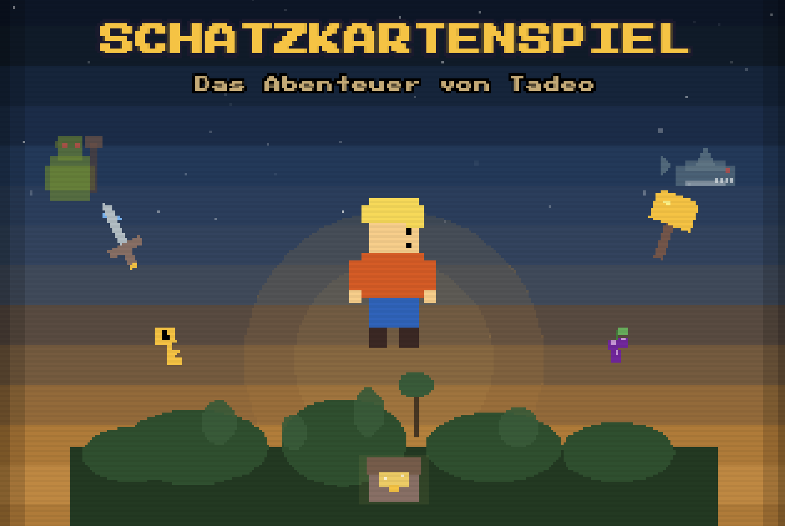

# Schatzkartenspiel (classic 2D)

> This is the original 2D version (1.0.0), kept for nostalgia. The current game is the 3D rebuild
> in the repository root. Run this one from inside this folder (`npm install`, then `npm run dev`).

A retro-style pixel-art adventure built with **Phaser 3**, **TypeScript**, and **Vite**.
You play as **Tadeo**, exploring a mysterious island, completing challenges, collecting key items,
and unlocking the final treasure.



## Highlights

- Programmatic pixel-art world and sprites (no external sprite sheets required)
- 10-stage adventure flow across overworld and dedicated challenge scenes
- Turn-based boss combat (Ogre + Shark)
- Inventory + quest milestone progression
- Dynamic dialogue and narration system
- Retro visuals, music, and SFX generated in-game

## Gameplay Flow

The game progresses through 10 milestones:

1. Arrival on the island
2. Volcano challenge
3. Lake tablets
4. Sword cave puzzle
5. Enchanted forest berry hunt
6. Ogre bridge battle
7. Village memory trials (key reward)
8. Mountain ascent
9. Sea crossing + shark battle
10. Treasure island finale

## Controls

- **Arrow keys**: Move / menu input in minigames
- **Space**: Interact, advance dialogue, confirm actions

## Tech Stack

- **Phaser** `^3.80.1`
- **TypeScript** `^5.9.3`
- **Vite** `^5.4.21`

## Getting Started

### Prerequisites

- Node.js 18+ (recommended)
- npm

### Install dependencies

```bash
npm install
```

### Run in development

```bash
npm run dev
```

### Build for production

```bash
npm run build
```

### Preview production build

```bash
npm run preview
```

## Project Structure

```text
src/
  assets/      # Programmatic sprite/sound generation
  data/        # Dialogues, enemies, quest definitions, items
  entities/    # Player and enemy entities
  scenes/      # Boot, title, overworld, challenges, finale
  systems/     # Audio, combat, dialogue, save, quest, inventory
  ui/          # HUD and combat/dialogue UI
  utils/       # Shared helpers
public/        # Static assets (audio/tilemaps)
```

## Notes

- Save/progress logic is handled in-game via the scene/system layer.
- The title screen style intentionally leans into an 80s adventure-poster aesthetic.
